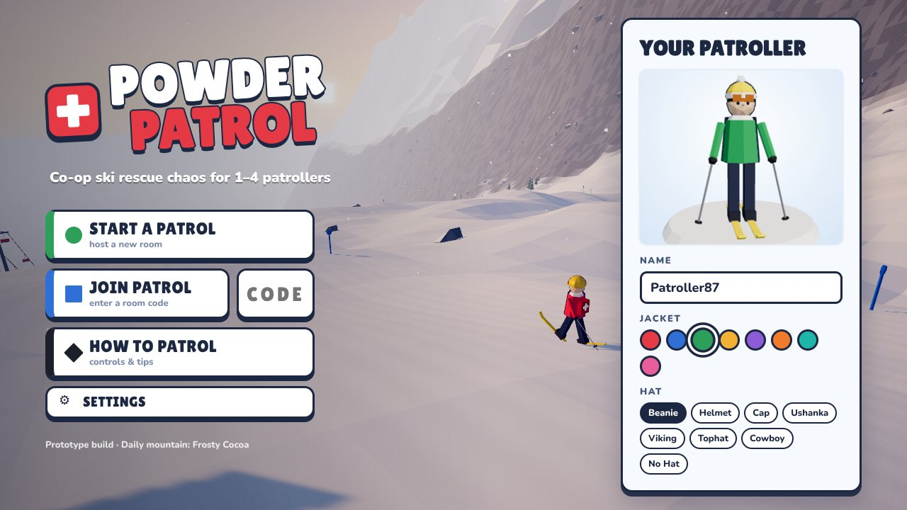
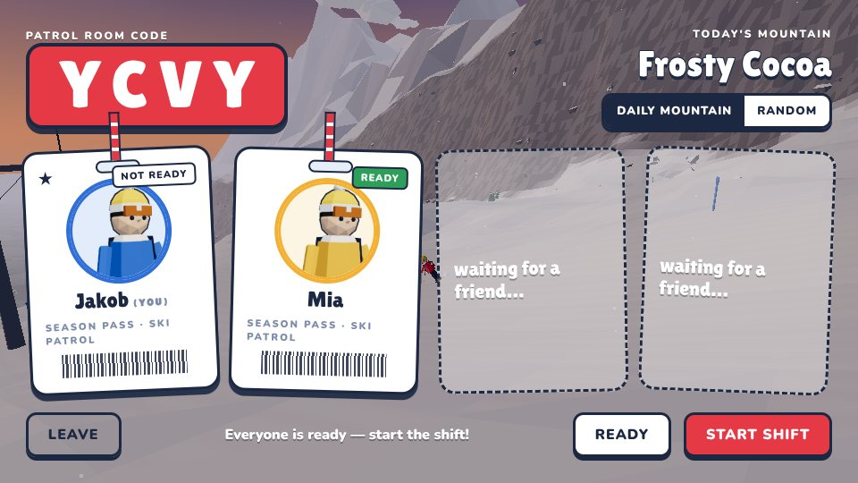
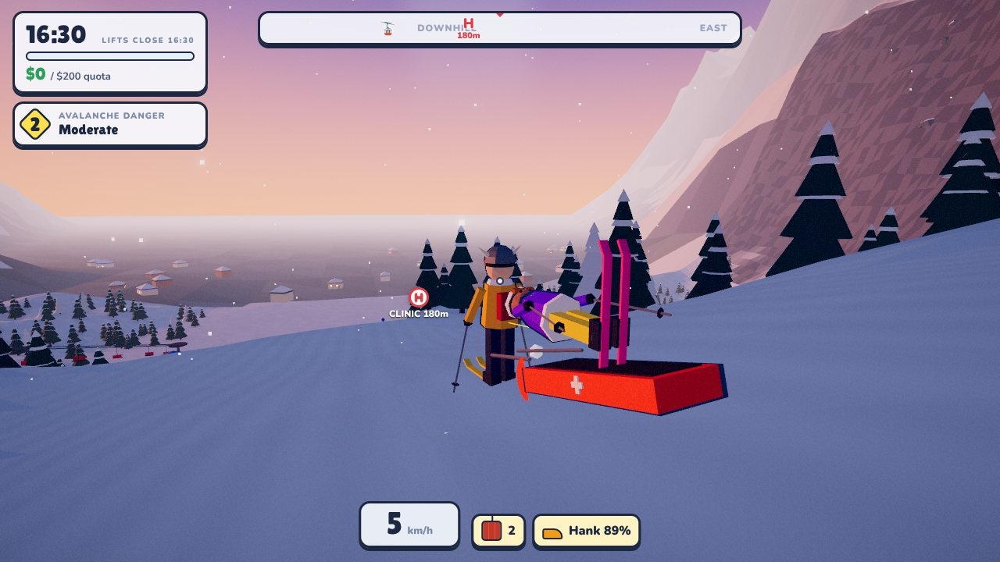
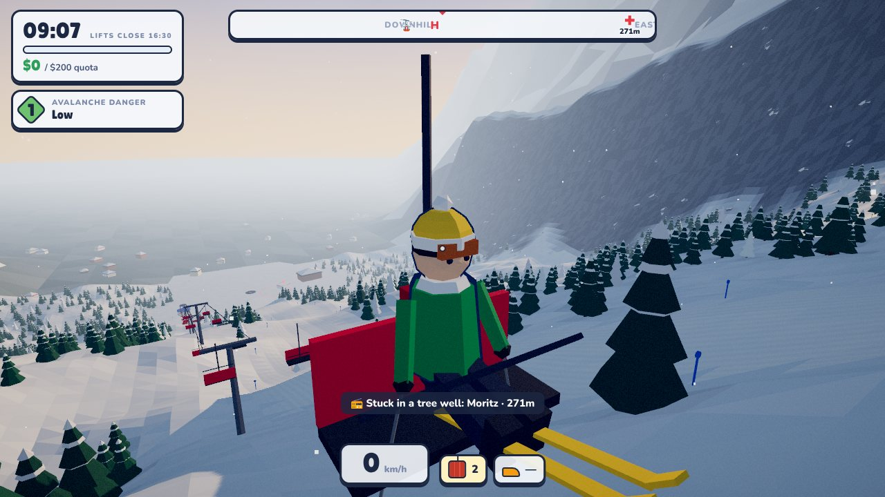
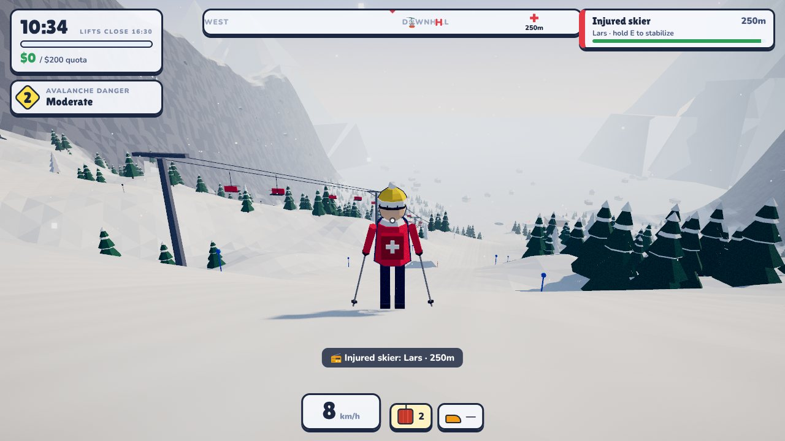
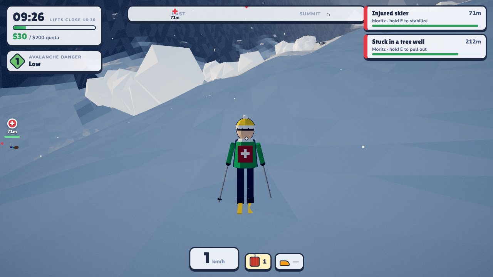
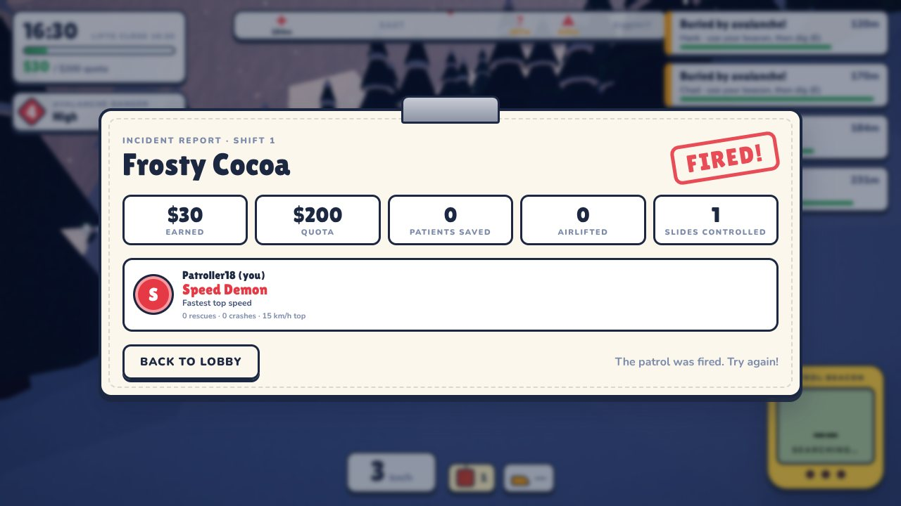

# ⛑️ POWDER PATROL

**Koop-Ski-Rettungs-Chaos für 1–4 Spieler · Low-Poly mit modernem Licht · Browser-Prototyp (Three.js + Node.js)**

> Ihr seid die **Pistenrettung Hintereck** eines viel zu vollen Skigebiets. Der Pieper geht, die **Leitstelle Talheim**
> funkt einen Einsatz durch, irgendwo steckt ein Tourist kopfüber in einer Baumgrube. Quittiert den Einsatz,
> sichert die Unfallstelle mit gekreuzten Ski, versorgt den Patienten in der richtigen Reihenfolge, bremst den Akja
> zu zweit ins Tal, sucht Verschüttete mit LVS, Sonde und Schaufel und weist den Rettungshubschrauber **„Föhn 1“** ein,
> bevor um 16:30 die Lifte stehen und die letzte Kontrollfahrt beginnt.


| | |
|---|---|
|  |  |
|  |  |
|  |  |
|  | |

---

## 1. Warum diese Idee? (Recherche)

| Erkenntnis | Quelle |
|---|---|
| Koop-Spiele haben im 1. Halbjahr 2025 auf Steam **4,1 Mrd. $** umgesetzt, so viel wie noch nie in einem Halbjahr. Treiber sind Indie-„Friendslop“-Hits wie R.E.P.O. und PEAK. | [Game Developer](https://www.gamedeveloper.com/design/what-developers-can-learn-from-the-indie-social-co-op-games-topping-the-steam-charts) |
| PEAK hat ~10 Mio. Kopien verkauft. Erfolgsrezept: Physik-Chaos, Fehler sind lustig statt frustrierend, **täglich wechselnde Map**. | [Game Developer](https://www.gamedeveloper.com/design/what-developers-can-learn-from-the-indie-social-co-op-games-topping-the-steam-charts), [GameRant](https://gamerant.com/coop-games-like-peak/) |
| RV There Yet? erreichte 100.000 gleichzeitige Spieler mit einem simplen Physik-Koop-Spiel. „Failure is entertaining, not punishing.“ | [GamesRadar](https://www.gamesradar.com/games/co-op/with-a-peak-of-100-000-concurrent-players-sending-it-straight-into-steams-best-sellers-chart-the-latest-indie-hit-is-a-silly-physics-based-co-op-game-about-driving-an-rv/), [80.lv](https://80.lv/articles/new-indie-co-op-adventure-where-you-drive-an-rv-reaches-100-000-players) |
| Lonely Mountains: Snow Riders (Low-Poly-Ski mit Mehrspieler) bekam Metacritic 87. Das zeigt, dass **Low-Poly-Ski + Multiplayer** ankommt, dort aber nur als Rennen. | [WayTooMany.games](https://waytoomany.games/2025/01/21/review-lonely-mountains-snow-riders/) |
| Ski-Patrol-Spiele gibt es nur als **Einzelspieler** (Ski Patrol 2024, Snow Scout VR). Ein **Koop-Rettungsspiel mit Lawinen gibt es nicht**. | [Steam: Ski Patrol](https://store.steampowered.com/app/1662570/_/), [Snow Scout](https://rawg.io/games/snow-scout) |
| Low-Poly-Stil: Flat Shading, starke gerichtete Sonne, farbiges Umgebungslicht, Nebel für Tiefe, Verlaufshimmel, Blob-AO. Muss auch als Thumbnail lesbar sein. | [Bugnet: Low-Poly Style Guide](https://bugnet.io/blog/low-poly-3d-a-style-guide-for-small-teams) |
| UI-Trend: minimalistisch, diegetisch, kontextabhängig („Clean Screen“), wenig Dauer-Overlays. | [Bonn University HUD-Studie](https://bonndoc.ulb.uni-bonn.de/xmlui/handle/20.500.11811/14207), [dev.to UI Trends](https://dev.to/red_apple_technologies/game-uiux-design-trends-and-best-practices-for-2025-e25) |
| Pistenpläne als Panorama mit Farben (grün/blau/schwarz) sind sofort lesbar. Davon ist die Trail-Map inspiriert. | [Cartographic Perspectives](https://cartographicperspectives.org/index.php/journal/article/view/cp67-tait) |

**Hook in einem Satz:** *„Lethal Company trifft Lonely Mountains auf der Skipiste: Rettet Touristen, sprengt Lawinen und grabt eure Freunde aus.“*

Clip-Momente für Streamer: fliegende Rettungsschlitten, Kollisionen mit Teamkollegen („Bowling Ball“-Award),
360°-Sprünge mit Patient, Lawinen, die einen Mitspieler verschütten, Hubschrauber-Evakuierung, „FIRED!“-Stempel.

---

## 2. Gameplay

**Schicht-Loop (≈ 6 Min, 09:00 → 16:30 Uhr im Spiel):**
1. **Alarmierung:** Pieper + Einsatzkarte der Leitstelle (Notfall-Stufe 1–3, Diagnose, Ort). Mit `X` quittiert ihr
   per Funk („Hier Hintereck 2, verstanden, übernehme“). Rufnamen *Hintereck 1–4*, deutscher Funk per Sprachausgabe.
2. **Unfallstelle absichern:** gekreuzte Ski 10 m oberhalb (`E`). Bleibt die Stelle ungesichert, während ihr dort
   arbeitet, kann ein **Folgeunfall** passieren.
3. **Erstversorgung:** echte Verletzungsmuster (Knie, Unterschenkel, Handgelenk, Schulter, Hüfte, Schädel-Hirn-Trauma,
   Wirbelsäule, Unterkühlung, Lawinenverschüttung). Maßnahmen wählt ihr mit `1`–`4` in der richtigen Reihenfolge
   (z. B. *HWS stabilisieren → Atemwege → Notfallcheck ABCDE → Wärmeerhalt*). Fallen wie „Schulter einrenken“,
   „Helm abnehmen“ oder „Schnaps zum Aufwärmen“ kosten Zustand. Rettungsdecke und Vakuummatratze sieht man am Patienten.
4. **Abtransport:** im **Akja** (Rack an der Rettungswache). Ein zweiter Retter übernimmt das **Bremsseil** hinten
   (`E`): Das hält den Akja ruhiger, halbiert die Schläge für den Patienten und bringt einen Bonus. Alternativ geht's
   mit dem **Rettungswagen** von der Talstation aus.
5. **Rettungshubschrauber „Föhn 1“** (Betreiber *Talflug*): Bei Kopf-, Wirbelsäulen- und Hüftverletzungen fordert ihr ihn
   mit `X` an. Ein Retter stellt sich auf eine ebene, freie Fläche (20×20 m ohne Bäume oder Fahrzeuge) und
   **weist ein** (`E` halten, Arme hoch). Ohne Landeplatz kreist der Hubschrauber, bei Sturm (Warnstufe ≥ 4) oder nach
   Sonnenuntergang fliegt er gar nicht. Die Crew holt den Patienten im Umkreis von 30 m selbst, sonst bringt ihr ihn im Akja hin.
6. **Pistenschluss:** Die Leitstelle meldet „Lifte stehen“, dann beginnt die **letzte Kontrollfahrt**. Nachzügler auf den
   Pisten müsst ihr ins Tal schicken.
7. **Einsatzprotokoll** am Schichtende: Patient, Diagnose, Maßnahmen (richtig/falsch, gesichert), Transportmittel,
   Einsatzdauer und Zustand bei Übergabe.

**Lawinen:** Ein **Lawinenlagebericht** (Tafel an der Wache, Stufe 1–5 *gering … sehr groß*) gibt die Lage vor. Mit
**Sprengladungen** (`G`) löst ihr kontrolliert aus. Verschüttete sucht ihr wie echt: **Signalsuche → Grobsuche (Pfeil)
→ Feinsuche unter 3 m** mit Ansagen („Zehn!“, „Feinsuche!“), dann **sondieren** (`E`, bis „Sondentreffer, eins zwanzig!“)
und gemeinsam **ausschaufeln**. Die Überlebenskurve ist erst flach und knickt dann steil ab (verkürzte „15-Minuten-Regel“).

**Fahrzeuge:** Motorschlitten und Quads (mit Akja am Haken), Pickup und Rettungswagen mit **Blaulicht und Martinshorn**
(`B`). Auf den Pisten fahren Touristen-Skifahrer herum. Wer einen umfährt, hat einen neuen Patienten.

**Roguelite-Run:** Tagesquote erfüllen, dann folgt die nächste Schicht (höhere Quote, mehr Lawinen, mehr Einsätze), plus **Shop**.
Quote verfehlt: **FIRED!** **Daily Mountain:** täglich ein neuer, für alle gleicher Berg.

> Vereinfachte Darstellung, **keine Erste-Hilfe-Ausbildung**. Echte Lawinen- und Erste-Hilfe-Kurse ersetzt das Spiel nicht.

### Steuerung
| Taste | Aktion |
|---|---|
| `A` / `D` | Carven / lenken |
| `W` / `S` | Hocke · Skaten / Schneepflug (im Fahrzeug: Gas / Bremse) |
| `Space` | Sprung (im Fahrzeug: Handbremse) |
| `E` | Interagieren: absichern, sondieren, graben, aufladen, Akja-Seil, Landeplatz einweisen (halten), einsteigen |
| `1`–`4` | Erstversorgungs-Maßnahme wählen |
| `X` | Funk: Einsatz übernehmen / Rettungshubschrauber anfordern |
| `Q` | Akja abstellen / Seil loslassen |
| `B` / `H` | Blaulicht + Martinshorn / Hupe |
| `G` · `F` | Sprengladung · Ping |
| `Tab` · `T` | Pistenplan · Chat |
| `R` (halten) | Zurück zur Rettungswache |

---

## 3. Grafik & UI

- **Low Poly mit modernem Licht:** facettiertes Heightfield-Terrain (Flat Shading), ACES-Tonemapping, Bloom,
  Vignette und Split-Toning (kühle Schatten, warme Lichter), weiche Schatten, die dem Spieler folgen, Exp²-Nebel.
- **Tageszeit als diegetischer Timer:** Morgenlicht, dann Mittag, dann Alpenglühen beim Liftschluss.
- **Schnee-Shader:** Glitzer (zufällige Funkel-Pixel, die durch Bloom leuchten) und Cord-Muster auf präparierten Pisten.
- Instanzierte Wälder mit Schneekappen, Blob-AO unter Bäumen, prozedurale Bergkette, Dorf im Tal, Wolken.
- Low-Poly-Partikel: Schneespray beim Carven, Pulverwolken, Lawinenwalze plus Schuttfeld, Explosionen, rote Signalrauch-Säulen, Schneefall (wird mit der Lawinenstufe dichter).
- **UI im Pistenschild-Design:** Menü-Buttons als grün/blau/schwarze Pistenschilder, Lobby als **Skipässe am Lanyard**,
  Kompassleiste mit Markern, Lawinen-Warnstufe als Raute (1–5), **gelbes LVS-Gerät** mit LCD, Funk-Feed,
  gemalter Pistenplan (Hillshade), Ergebnis als **Einsatzbericht auf dem Klemmbrett** mit Stempel.
- CC0-3D-Assets (Quaternius, ambientCG; siehe `client/assets/CREDITS.md`) plus prozedurale Modelle (Akja, Hubschrauber,
  Fahrzeug-Livery, Requisiten). Sound komplett per WebAudio (Pieper, Martinshorn, Rotor, Funk-Rauschen, Folk-Loop),
  Funksprüche per deutscher Sprachausgabe (Web Speech API, abschaltbar).
- **Eigene Identität statt geschützter Zeichen:** Das Emblem der *Pistenrettung Hintereck* (orange/petrol, Akja-Silhouette
  mit Pulslinie) ersetzt jedes Kreuz. Rotes Kreuz, Schweizer Kreuz, Star of Life, Edelweiß-Abzeichen sowie echte
  Organisationsnamen (Bergwacht, Bergrettung, DRK, ADAC …) und Notrufnummern kommen bewusst nicht vor.

---

## 4. Starten

```bash
cd powder-patrol
npm install
npm start            # → http://localhost:3000
```

Dann **„Start a Patrol“** klicken und den 4-stelligen Code an Freunde schicken (dasselbe Netzwerk oder Server mit offenem Port 3000).
Für Tests mit kurzer Schicht: `PP_SHIFT_SECONDS=90 npm start`.

```bash
npm test             # 17 Tests: Rettungs-Loop über WebSockets, Erstversorgung, Hubschrauber/Landeplatz, Sonde,
                     # Akja-Seil, Pistenschluss, Skiphysik, Lift, Schlitten, Determinismus
```

---

## 5. Architektur

```
powder-patrol/
├── shared/            # läuft auf Server UND Client (deterministisch)
│   ├── mountain.js    # Berg-Generator: Heightfield, Pisten, Lawinenpfade, Lift, Bäume, Kollision
│   ├── constants.js   # Balancing, Shop, Awards, Verletzungen + Maßnahmen, Funksprüche, Rettungs-Regeln
│   └── rng.js         # Seeded RNG + Noise
├── server/
│   ├── index.js       # HTTP (statische Dateien) + WebSocket, Raum-Codes
│   └── room.js        # autoritative Spiellogik: Alarmierung, Erstversorgung, Akja, Hubschrauber, Lawinen, Pistenschluss, Protokoll
├── client/
│   ├── index.html / style.css
│   └── js/
│       ├── main.js       # App-Zustände, Menü-Cinematic mit KI-Skifahrern, Input
│       ├── game.js       # eine Schicht: Netzwerk-Entitäten, Interaktionen, Kamera, HUD
│       ├── skier.js      # Skiphysik (Carven, Hocke, Sprünge, Crashes, Lift, Schlitten am Seil)
│       ├── renderer.js   # Himmel-Shader, Tageszeit, Schatten, Post-Processing
│       ├── world.js      # Terrain-Mesh + Schnee-Shader, Wald, Lift, Hütten, Bergkette
│       ├── models.js     # Emblem, Akja, Hubschrauber „Föhn 1“, gekreuzte Ski, Sonde, Landeplatz, Rettungsdecke …
│       ├── characters.js # animierte Patroller/Touristen (Skinned Meshes, Ausrüstung an Knochen)
│       ├── vehicles.js   # Motorschlitten, Quad, Pickup, Rettungswagen: Physik, Livery, Blaulicht
│       ├── npcs.js       # Touristen-Skifahrer auf den Pisten
│       ├── voice.js / i18n.js
│       ├── effects.js / avalanche.js / audio.js / ui.js / net.js
└── test/
```

**Netzcode:** Der Server simuliert mit 20 Hz und sendet Snapshots mit 15 Hz. Clients interpolieren mit 120 ms Verzögerung.
Die eigene Skiphysik läuft **client-seitig** (120-Hz-Substeps) für null Input-Lag. Der Server validiert Distanzen bei allen
Interaktionen. Berg und Lawinenfront sind deterministisch aus Seed und Zeit, deshalb sieht jeder Client dieselbe Lawine,
ohne dass Partikel übertragen werden.

---

## 6. Weg nach Steam (Roadmap)

**Vertical Slice (dieser Stand):** kompletter Loop, 1–4 Spieler, Lawinen, Shop, Awards, Daily Mountain.

1. **Desktop-Build:** mit Electron (oder NW.js) verpacken. Der Node-Server läuft im Host-Client mit
   („Host & Play“, kein eigener Server nötig).
2. **Steamworks:** [steamworks.js](https://github.com/ceifa/steamworks.js) für Lobbys, Freundes-Einladungen,
   Achievements (Awards bieten sich an) und **Steam Networking Sockets/Relay** statt offener Ports.
3. **Proximity Voice Chat:** Treiber der Friendslop-Hits. Patienten, die „ins Funkgerät“ schreien, wären lustig.
4. **Content:** weitere Berge/Biome (Gletscher mit Gletscherspalten, Nacht-Schicht mit Stirnlampen), Lawinenhund,
   Sondierkette ohne LVS, morgendliche Sprengrunde mit Lawinenkommission, Bergung aus dem Sessellift.
5. **Juice:** Ragdolls, Proximity-Chat-Lipsync, Kosmetik (Mützen sind schon da) als freischaltbare Belohnung.
6. **Steam-Seite früh live** (Wishlists sammeln), Demo zum Steam Next Fest, Preisziel **7,99–9,99 $**
   (Friendslop-Sweetspot, Friend-Pass/4-Pack).
7. Lokalisierung (DE/EN zuerst, dann ES/PT-BR/RU/ZH), Controller-Support (Steam Deck).

> Status: spielbarer Prototyp und kein fertiges Steam-Produkt. Für einen Release braucht es noch Playtests,
> Balancing, Audio/Art-Polish und die Steamworks-Integration (Steam Direct Gebühr 100 $).
